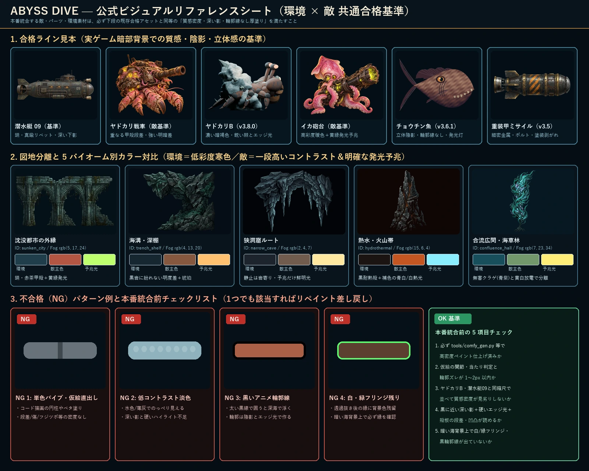

# ABYSS DIVE — 共通アートスタイルガイド（環境 × 敵キャラクター 擦り合わせ基準）

最終更新: 2026-11-25（Antigravity 環境アート / Hermes 敵キャラクター 共通基準）

環境アート（背景多層・地形・植物・遺跡）と敵キャラクター（造形・モーション・発光）を別セッション・別担当で制作しても、1つの深海世界として完全に馴染むようにするための共通ルールです。

### 公式ビジュアルリファレンスシート（必読・検品基準）

- 実体ファイル: [`docs/art_reference_sheet.webp`](art_reference_sheet.webp)（再生成: `python abyss-depth-lab/tools/build_art_ref_sheet.py`）
- **監督・検品担当（Vision モデル）は、新しい敵や環境アセットを評価する前に必ずこのシートを開き、質感密度・深い影・図地分離・NG 4 パターンと照合すること。**

---

## 1. 共通の絵柄・質感基準

- **描画スタイル**: **アニメ調の黒い輪郭線（線画）なし**のセミリアリスティック厚塗り（ペインタリー／3Dペイント調の立体陰影）。
- **ディテール密度**: 濡れた岩肌・錆びた鋼板・フジツボ・吸盤・生体組織など、ズームしても破綻しない高密度なテクスチャ感を持つ。フラットなベタ塗りやベクター図形調は避ける。
- **エッジ処理**: 白縁・黒縁のフリンジを完全除去したクリーンな透過エッジ（WebP RGBA）。
- **ライティング基準（原画側）**:
  - 強い単一方向の影を焼き込みすぎず、やや斜め上からの柔らかい拡散光を基本とする（実際のドラマチックな明暗・スポットライト・法線照光は WebGL2 レンダラ側で動的にかける）。
  - 環境アセットは原則 `color` + `normal (*_n.webp)`、発光部があるものは `emissive (*_e.webp)` の 3 マップ構成。

### 1.1 制作パイプライン規則・不合格（NG）ゲート（2026-11-25 追記）
- **コード単体描画の禁止（本番アセット）**: Python（Pillow）の図形塗り・単調ノイズや、Blender の簡易プリミティブ＋手続き色だけで作った「プラスチックパイプ調・ベタ塗り調」の素材は **当たり判定・モーション検証用の仮絵（プロトタイプ）まで** とし、本番 `assets/` への統合は禁止とする。
- **本番アセットの必須手段**: 本番の敵・パーツ原画は必ず **画像生成ベースの高密度ペイント** で仕上げる。ローカルの ComfyUI（`D:\AI\ComfyUI\run_nvidia_gpu.bat` / `http://127.0.0.1:8188`）を叩く共通 CLI [`tools/comfy_gen.py`](../tools/comfy_gen.py) を用意しているため、Hermes を含む全担当は以下を標準パイプラインとする（既定モデルは高密度厚塗り・岩肌・甲殻向けの SDXL ファインチューン `--model juggernaut`、軽量試行は `--model dreamshaper`）：
  - **新規パーツ生成**: `python abyss-depth-lab/tools/comfy_gen.py --model juggernaut --prompt "..." --remove-bg --out abyss-depth-lab/assets/xxx.webp`
  - **仮絵（Blender/Pillow）からの厚塗りリペイント**: `python abyss-depth-lab/tools/comfy_gen.py --mode img2img --input blockout.png --denoise 0.58 --model juggernaut --prompt "..." --remove-bg --out abyss-depth-lab/assets/xxx.webp`（関節位置・シルエットを維持したまま高密度テクスチャへ変換）
- **統合前チェック（同定規レビュー）**: 必ず既存の `assets/hermit-tank.webp`・`assets/submersible-09.webp` と同縮尺で並べ、**質感密度（傷・付着物・甲殻の立体陰影）が同水準であること** を確認してから統合する。

---

## 2. 図地分離（Figure-Ground Separation）の原則

背景と敵が同じ彩度・色相で潰れないよう、役割を明確に分けます。

| 要素 | 色相・彩度レンジ | 明度レンジ | 役割 |
| :--- | :--- | :--- | :--- |
| **環境（遠景・中景・岩盤）** | **低彩度・寒色〜無彩色寄り**（スレートブルー、黒玄武岩、深い青緑）。熱水帯も岩自体は黒〜暗灰に抑え、亀裂だけ琥珀・赤錆を点在させる。 | 低〜中暗（環境光＋動的光源で立体を起こす） | 空間の奥行き・スケール感・バイオームの空気感を作る舞台 |
| **敵キャラクター・危険予兆** | **中高彩度・暖色または明確な補色アクセント**（既存の `hermit-tank` の肉色ピンク＋錆茶＋黄緑発光、`squid-gunner` の鮮やかピンク＋黄緑砲口を基準）。 | 中〜高（暗がりでも艇ライトや発光部で輪郭が即座に読める） | 視認性最優先のプレイ対象。背景より彩度・コントラストを一段高く保つ |
| **無害な環境生物・発光植物** | 澄んだシアン・淡い青紫・柔らかい琥珀。攻撃予兆の強い黄緑／赤点滅とは色相・点滅テンポを分ける。 | 発光部のみ HDR ブルームでほのかに光る | 世界の生命感と道標（戦闘の邪魔をしない） |

---

## 3. バイオーム別カラー＆生態連携表（環境 ↔ 敵）

`js/world-biomes.js` で定義された各バイオームの環境色と、そこに棲む敵（Hermes 担当）の推奨トーン対比です。

| バイオーム ID | 環境の主色・水色 | 環境アートの代表素材 | 敵キャラクター側の調和・対比指針（Hermes向け） |
| :--- | :--- | :--- | :--- |
| `sunken_city` 沈没都市の外縁 | 深い青緑 Fog `rgb(5,17,24)` | `mid_ruins_arch`, `cliff_spire`, `flora_coral_cyan` | 錆びた人工構造物・赤〜ピンク系甲殻＋黄緑/琥珀発光（既存 `hermit-tank`, `squid-gunner` 基準） |
| `trench_shelf` 海溝・深棚 | 暗い青緑・黒岩 Fog `rgb(4,13,20)` | 黒岩棚、青白発光植物、暖色の基地ドック灯 | 暗い岩棚に紛れすぎない明度の甲殻・発光器官。ライト照射で肉や関節の質感が浮かぶ設計 |
| `narrow_cave` 狭洞窟ルート | 極暗スレート青 Fog `rgb(2,4,7)` | `cave_stalactite`, `cliff_overhang` | 灰褐色の小型〜中型待ち伏せ型。**静止時は岩に近く、攻撃予兆だけ鮮明な暖色/白光**で視認させる |
| `hydrothermal` 熱水・火山帯 | 黒玄武岩＋琥珀霧 Fog `rgb(15,6,4)` | `volcanic_vent`（黒岩＋琥珀亀裂）, 熱水プルーム | 黒い耐熱殻に赤錆・金属光沢の斑。背景が琥珀寄りなので、**敵の発光・予兆は白熱黄〜青白放電**など補色寄りにすると視認性抜群 |
| `confluence_hall` 合流広間・海草林 | 澄んだ青緑〜淡い青紫 Fog `rgb(7,23,34)` | `hall_giant_kelp`, `creature_jelly`, `creature_manta` | 苔色の斑がある中型〜大型個体や、傘を縮めて放電するクラゲ型。**背景の無害クラゲ（淡い青紫・穏やか）と、敵クラゲ（明確な輪郭＋強い白/黄放電予兆）**を形と光で分離 |

---

## 4. 座標・バイオーム参照の共通インターフェース

敵の配置やバイオーム別カラー・体格補正を実装する際は、以下の純粋モジュールをそのまま参照してください。

- `js/trench-rules.js`: `createTrench(baseMarker)` が返す `layout`（`solids`, `biomes`, `vents`, `gorgeX0..hallX1`, `floorY`, `deepFloorY`）
- `js/world-biomes.js`: `sampleBiomeAt(x, y, layout)` → `{ primaryId, label, weights, fogColor, turbidity, ambientBoost, darkMaskMul }`

これにより、描画・当たり判定・透過マップ・敵の生態配置が **1px のズレもなく同一ワールド** を共有できます。
