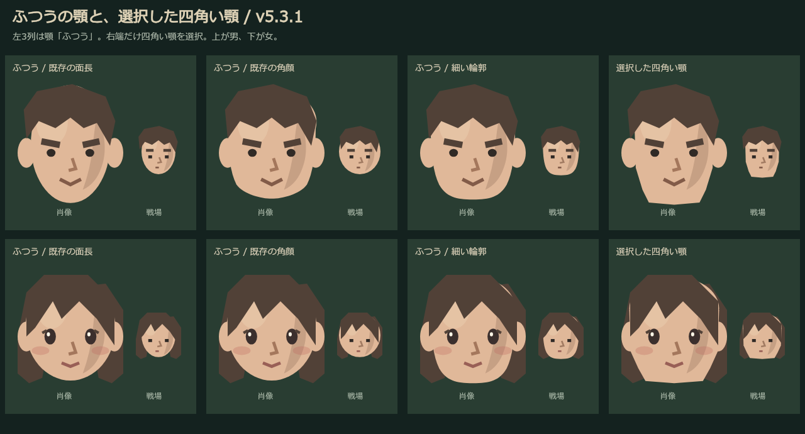
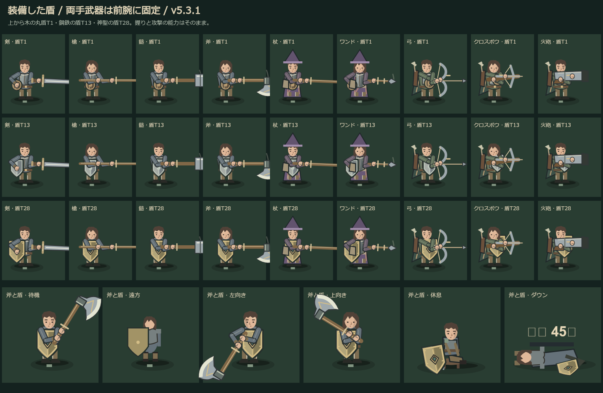

# 普通の顎・盾表示（v5.3.1 / ゲームキャッシュ v188）

2026-10-11、再起動後に「普通の顔まで顎が角ばっている」と指摘された。普通の顎の描画を修正し、停止前に確認していた盾の非表示も仕上げた。

## 顔

- 顎が普通でも、角顔・細い輪郭で下顎を直線の多角形にしていた。標準の下顎を曲線へ変更し、既存の角顔の下端も丸めた。頬の直線的な影は、輪郭からはみ出さない柔らかい曲線へ。
- 明示的に選んだ「四角い顎」の造形は残す。出た顎・大きい顎・尖った顎・割れた顎、目・鼻・髪・飾りと保存された個人差は保持。人物の顔は再抽選しない。
- 肖像・戦場の顔・キャッシュへ共通反映。ボブの首元と、筋肉魔法師／筋肉衛生士だけの体格条件はそのまま。

[修正前](previews/default-faces-before-v5.3.1.png)・[男の身だしなみ](previews/default-face-male-mobile-v5.3.1.png)・[女の身だしなみ](previews/default-face-female-mobile-v5.3.1.png)。

## 盾

- 武器が両手持ちの場合と二刀の職種で、盾を描かない条件があった。片手武器は添え手側、槍・鎚・斧・杖・弓・クロスボウ・火砲・二刀は支える前腕に固定して描く。
- 腕と武器の握りは従来の共通姿勢を使う。盾のために両手を柄から外さない。遠方では小さい盾の輪郭を残し、休息では椅子の脇、ダウン時は地面へ倒した盾を描く。
- 木・青銅は丸盾、鉄以降は縁と下端のある盾。高ティアでは大きさ・金属縁・中央の紋章が増す。盾がない人物には追加しない。
- 変更は見た目のみ。盾の装備条件、防御・HP・ブロック、攻撃速度、鎚／斧の武器ATK10倍と剣の速撃は維持。

[斧で攻撃中](previews/shield-axe-attack-mobile-v5.3.1.png)・[弓で攻撃中](previews/shield-bow-attack-mobile-v5.3.1.png)。

## 確認と引き継ぎ

- 顔・保存・ボブ・体格・近景／遠景・腕・盾・Canvasの関連10ファイルのテストに合格（顔の先行6、顔＋盾の9に重複あり）。既存顔の角、影のはみ出し、9武器×8方向の装備した盾、腕長・両手の握り、休息・ダウン、描画による乱数・能力・保存の変化なしを確認。
- 同時テスト数は2以下、ブラウザは1つずつ。375幅／DPR2で男女の普通の顎、選択と保存、斧／弓の攻撃入力、盾と握り、能力不変、横はみ出しなし、ページ例外0を確認。
- キャッシュv188で初回オフライン新遠征・廃坑入場・描画に成功。iPhone実機は未確認。終了後、確認用Chromeと一時サーバーを停止。
- 共有ファイルと他ゲームは変更なし。このセッションではcommit／pushなし。編集前88ファイル：`backups/20261011-before-standard-faces-shields.zip`（SHA256 `6ef4f17db42b10b7ab8dbfa3b017a36d4beba1b728e7bb87f921ff2846c3d913`）。

道具：`tools/preview-default-faces.mjs`、`tools/preview-shield-carry.mjs`、`tools/playtest-standard-faces-shields.mjs`。ブラウザ報告：[JSON](previews/standard-faces-shields-playtest-v5.3.1.json)。
