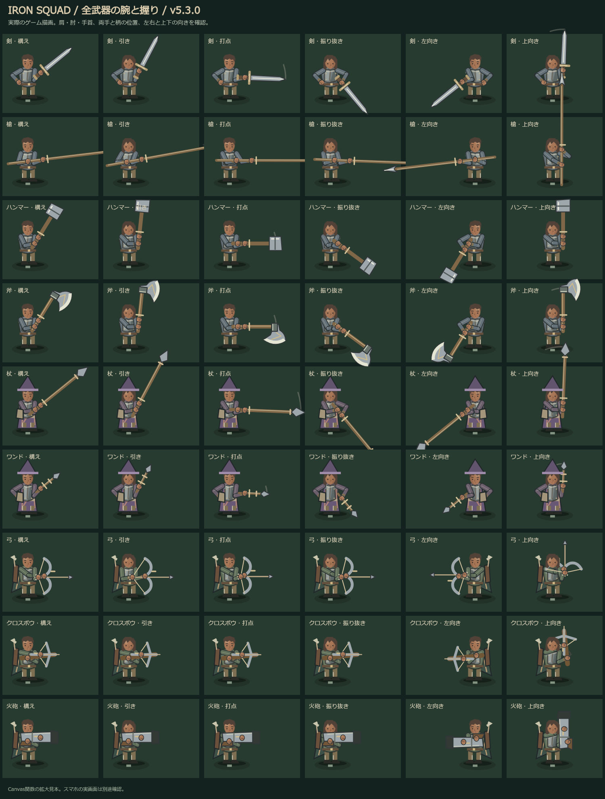
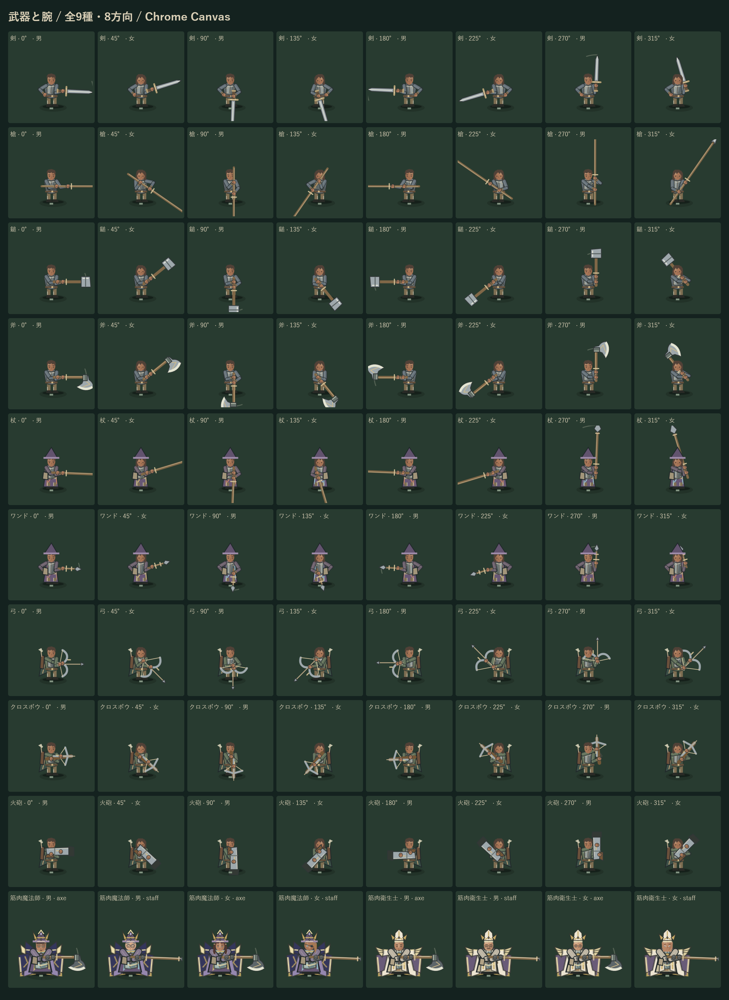

# 斧・鎚の攻撃力と、全武器の持ち手（v5.3.0 / ゲームキャッシュ v187）

2026-10-11の希望を反映。斧を鎚と同じカテゴリへ加え、両方の武器攻撃力を従来の10倍にした。剣は速撃の方針で攻撃力を据え置き。全武器の肩・肘・手首・握る位置を見直した。

## 武器の扱い

- 斧は独立した見た目と名称を持つ。石刃から神斧まで7素材×4製造段のT1〜T28。通常ドロップ・箱・商人と、装備・比較・譲渡・配備・保存へ接続。
- 熟練度と得意武器は「鎚・斧」の1カテゴリ。どちらを使っても同じ熟練度が育つ。既存の8本の熟練度を維持。必要筋力、間合い、攻撃速度、打点、ノックバックと強撃は鎚と共通。強撃は既存のクラッシュブロー／メガスマッシュを使用。
- 10倍は武器の装備ATKへ一度だけ適用する。品質・強化・限定品補正を含めた従来値を10倍にし、戦闘処理では再度掛けない。勇者の専用鎚にも適用。本人の基礎能力や武器以外の装備もATKに入るため、最終ダメージの比率は人物・装備で変わる。
- 旧装備は `heavyAttackVersion:1` を付けて一度だけ補正。隊長、兵士、予備、候補、バッグ、共用箱、商人の在庫と活動中の勇者に反映。ID・品質・強化段・個体差・熟練度を維持。繰り返し読込・強化しても100倍にはならない。装備の比較試算は元の品を変更しない。
- 剣の攻撃力・技能は変更なし。通常の基礎間隔0.52秒、基本モーション0.24秒という速撃を維持。鎚・斧の基礎間隔は0.98秒。個人の攻撃速度、個体差、熟練度がさらに反映される。

## 腕・手と刃の描画

- 剣・槍・鎚・斧・杖・ワンド・弓・クロスボウ・火砲の9種類を共通の肩と固定長の上腕・前腕へ接続。両手の間隔を保ったまま、握りを両腕の届く範囲へ収める。
- 肘を顔の上へ折り返す構えを解消。片手武器の空いた腕や盾も手につなげる。杖の添え手が柄から浮いていた位置を修正。指は柄をつかむ丸い形へ統一。
- 弓は弦を引く手、クロスボウと火砲は支える手と反動を描く。射撃方向を保持し、体の左右反転で武器だけ別方向へ向く固定描画を廃止。
- 腕は頭より手前に描かず、上方向へ向けた武器は頭の後ろへ置く。近景・遠景、隊長・兵士・護衛、男女と筋肉術師の両体格に対応。体格の条件は筋肉魔法師・筋肉衛生士だけのまま。
- 斧は扇状に広がる刃、湾曲した刃先、柄を留める部分、素材に応じた色と上位の刻印で描き分ける。遠景も鎚と異なる刃の輪郭。

## 確認

- 全92テスト合格。9武器×8方向×21段階×2体格の腕長・握り・戻し、T1〜T28の斧、正確な武器ATK10倍、専用装備、実際の通常攻撃／強撃、既存保存の複数回読込と強化を検証。
- Chromeの375幅／DPR2で全9武器の攻撃ボタン、9武器×8方向の描画、男女、クラス3の筋肉術師、横はみ出しなし、ページ例外0を確認。
- ゲームキャッシュv187で初回オフライン新遠征・廃坑入場・描画に成功。iPhone実機は未確認。
- 編集前88ファイルは `backups/20261011-before-heavy-weapons-grips.zip`。SHA256: `b1ab99d8362cda7f05e8458c7b09699f6432892d8f958ddd32abfeaec3dbfe9e`。共有ファイルと他ゲームは編集なし。作業中に別セッションが実装を `290caff` へ取り込んだことをGit履歴で確認。このセッションではcommit／pushを実行していない。追加の記録・保存確認テストは作業差分。

実画面：[斧](previews/axe-mobile-v5.3.0.png)・[弓](previews/bow-mobile-v5.3.0.png)・[火砲](previews/cannon-mobile-v5.3.0.png)。

再確認：`tools/preview-weapon-grips.mjs`、`tools/playtest-heavy-weapons.mjs`、`tools/check-dungeon-offline.mjs`。
